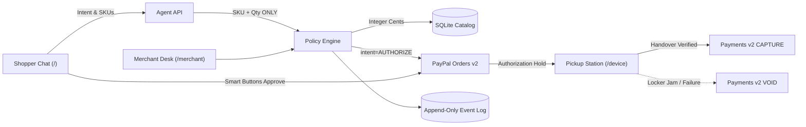

# Proofed

**Authorize now. Capture only after proof of handover.**

Proofed is an agentic physical commerce platform for stadium shops, micro-stores, and unattended locker kiosks. An AI shopping assistant guides the customer, the backend initiates a PayPal Orders v2 transaction with `intent=AUTHORIZE`, the visitor approves the temporary hold, and a physical handover station records proof of delivery before funds are captured. If handover fails, the hold is safely voided or substituted within budget.

Built for the **PayPal AI Hackathon** (November 2026).

---

## The Core Problem

When an autonomous AI agent buys an item in a physical venue, the critical challenge is not the chat interface — it is **payment accountability**:

- **Pre-charging risk**: Capturing money before the shopper holds the physical product leads to disputes if a locker jams, the bin is empty, or the buyer walks away.
- **Unchecked AI pricing**: Language models hallucinate prices, discounts, and currency totals.
- **The PayPal solution**: PayPal Orders v2 supports `intent: "AUTHORIZE"`, holding shopper funds for up to 29 days with a 3-day honor period. Proofed ties this financial hold directly to verifiable physical handover evidence.



---

## Key Capabilities

- **Natural Dialogue with Hard Budget Bounds**: Shoppers speak naturally (e.g. *"I have a $20 budget. Do you have a keychain?"*). Budgets are parsed into integer cents and strictly enforced server-side.
- **Zero-Trust AI Pricing**: The LLM never touches monetary figures. Prices and stock come strictly from the server's SQLite catalog.
- **PayPal JS SDK Smart Buttons**: Seamless hold approval with official PayPal sandbox authentication.
- **Physical Handover Verification (`/device`)**: Stand-in terminal for a smart locker or venue kiosk requiring a pickup code, station signature, and optional photo hash.
- **Graceful Failure & Item Substitution**: If a locker jams or an item is damaged, the hold is maintained while the agent proposes a catalog-backed replacement, or auto-voids the authorization.
- **Auditable Merchant Desk (`/merchant`)**: Full order ledger powered by AG Grid Community, complete with raw event logs, PayPal transaction IDs, and manual override capabilities.

---

## Application Screens

| Screen | Route | Purpose |
|---|---|---|
| **Presenter View** | [`/demo`](http://localhost:3000/demo) | Side-by-side view with live transaction receipt, shopper chat, and pickup terminal |
| **Shopper Experience** | [`/`](http://localhost:3000/) | Natural language shopping assistant, product shelf, and PayPal Smart Buttons |
| **Pickup Station** | [`/device`](http://localhost:3000/device) | Software kiosk verifying pickup code and capturing payment |
| **Merchant Desk** | [`/merchant`](http://localhost:3000/merchant) | High-density AG Grid order table, KPIs, and append-only event drawer |

### Screenshots


*Additional interface screenshots available in [`docs/screenshots/`](docs/screenshots/).*

---

## Repository Structure

```
Proofed/
├── app/                  # Next.js 15+ full-stack application (frontend + backend APIs)
│   ├── app/              # App Router pages and REST endpoints
│   ├── components/       # Composable React UI components
│   ├── lib/              # Business logic, PayPal client, policy engine, SQLite DB
│   ├── public/           # Static assets & product SVG illustrations
│   ├── scripts/          # Database seeding, reset, packaging, and renaming scripts
│   └── tests/            # Vitest unit/integration tests and Playwright e2e tests
├── docs/                 # Documentation, hackathon research, and demo guides
│   ├── ARCHITECTURE.md   # System architecture, state machine, and threat model
│   ├── DEMO_SCRIPT.md    # 3-minute video pitch recording walkthrough
│   ├── RESEARCH.md       # Original PayPal hackathon research & API specifications
│   └── screenshots/      # High-resolution screenshots of the running app
├── skills/               # Reusable agent operational playbooks
│   ├── paypal-sandbox/   # PayPal sandbox setup, API testing, and webhooks
│   ├── agent-policy-eval/# Agent guardrail validation and tool evaluation
│   └── demo-runner/      # Demo reset and automated Playwright execution
├── rules/                # Project rules and engineering invariants
│   ├── fintech-guardrails.md # Strict monetary, pricing, and authorization rules
│   ├── design-system.md      # Swiss/Fintech visual rules & accessibility standards
│   └── codebase-standards.md # Node.js, Next.js, TypeScript, and SQLite standards
├── AGENTS.md             # Master operations manual for autonomous coding agents
├── LICENSE               # MIT License
└── package.json          # Root workspace scripts delegating to app/
```

---

## Quickstart

### Prerequisites
- **Node.js 22+** (tested on Node 24). Uses Node's built-in `node:sqlite` module (no native compiler build steps needed).
- **npm 10+**

### 1. Setup Environment
```bash
cp app/.env.example app/.env
# Fill PAYPAL_CLIENT_ID, PAYPAL_CLIENT_SECRET, and MINIMAX_API_KEY in app/.env
```

### 2. Install & Run
```bash
# Install dependencies
npm install

# Seed the SQLite catalog with products (including seeded out-of-stock item)
npm run seed

# Start the local development server (http://localhost:3000)
npm run dev
```

---

## Testing & Quality Assurance

```bash
# Run core unit tests (state machine, budget parser, policy engine)
npm test

# Run PayPal sandbox integration tests
npm run test:paypal

# Run agent conversation & tool execution tests
npm run test:agent

# Run all Vitest suites
npm run test:all

# Run Playwright E2E and WCAG AA contrast tests
npm run test:e2e
```

---

## Demo & Utility Scripts

- **Reset Demo State**: `npm run demo:reset` (restores catalog, clears test orders, resets out-of-stock items)
- **Refresh Screenshots**: `npm run screenshots` (uses headless Playwright to snapshot all screens)
- **Package Release**: `npm run pack` (creates a clean distributable zip archive)
- **Rename Project**: `npm run rename "New Name" new-slug` (updates branding across configs and docs)

---

## Documentation & References

- [System Architecture & State Machine](docs/ARCHITECTURE.md)
- [PayPal Hackathon Technical Research](docs/RESEARCH.md)
- [3-Minute Demo Recording Script](docs/DEMO_SCRIPT.md)
- [Agent Operational Manual](AGENTS.md)
- [Fintech & Payment Guardrails](rules/fintech-guardrails.md)
- [Design System & UI Craft Rules](rules/design-system.md)

---

## License

MIT License. See [LICENSE](LICENSE) for details.
