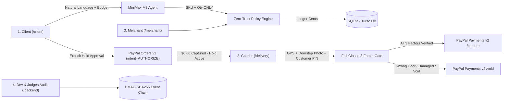

# Proofed

**Authorize now. Capture only after verified proof of physical handover.**

Proofed is the trust and settlement layer between autonomous AI commerce agents and the physical world. When an AI shopping assistant proposes an order, the buyer approves a **conditional payment hold** via PayPal Orders v2 (`intent=AUTHORIZE`, `$0.00` captured upfront). Funds remain held on PayPal until a **tri-factor physical handover protocol** (GPS geofence, fail-closed multimodal vision inspection via `MiniMax-M3.1-Flash`, and a courier-blind customer PIN) verifies delivery at the doorstep. Only upon verified handover does the server execute PayPal Payments v2 `/capture`. If delivery fails (wrong door, damaged package, geofence violation), the hold is never captured and can be re-dispatched or safely voided via `/void`.

Built for the **PayPal AI Hackathon** (November 2026) · **Live App**: [https://proofed-ai.vercel.app](https://proofed-ai.vercel.app)

---

## 1. The Core Problem & PayPal Thesis

An AI agent can find products and initiate a checkout in milliseconds, but it cannot assume physical delivery succeeded:

- **Pre-charging risk**: Capturing funds (`intent=CAPTURE`) before physical handover exposes shoppers and merchants to disputes when a courier drops a package at the wrong apartment, leaves a crushed box, or fails delivery.
- **Unchecked AI pricing**: Language models hallucinate prices, discounts, and currency totals.
- **PayPal's Conditional Settlement Primitive**: PayPal Orders v2 supports `intent: "AUTHORIZE"`, placing a 29-day authorization hold (with a 3-day honor period). Proofed binds `/v2/payments/authorizations/{id}/capture` and `/void` directly to cryptographic and multimodal physical handover evidence.



---

## 2. Hardened Security & Payment Invariants

Following our technical security audit, Proofed enforces strict server-side invariants so that **an untrusted client can submit evidence, but cannot declare payment authorization, physical verification, or settlement success**:

1. **Strict Capture Gate (`DELIVERY_CONFIRMED` Only)**:
   - `captureOrder()` in `app/lib/orders.ts` rejects any order not in `DELIVERY_CONFIRMED` status and verifies that a persisted `delivery_confirm` evidence record or customer receipt confirmation exists in the database. No code path can capture an `AUTHORIZED` order without prior handover verification.
2. **Fail-Closed Multimodal Vision & GPS (`app/lib/vision-audit.ts`)**:
   - Live photographs are analyzed by **`MiniMax-M3.1-Flash`** with dynamic bounding box extraction (`doorNumberBox`, `packageBox`) and zero prompt bias.
   - Missing photographs, API timeouts, malformed responses, or missing GPS coordinates **fail closed** (`captureAuthorized: false`, `overallHandoverScore: 0`).
   - Demo sample presets (`Door #15`, `Door #13`, `Damaged box`) are explicitly labeled `source: "demo-simulation-preset"`.
3. **Courier-Blind One-Time Recipient PIN**:
   - The courier endpoint (`GET /api/orders?view=courier`) redacts `pickup_code` (`pickup_code: null`, `pickup_code_masked: "••••••"`).
   - The courier interface (`/delivery`) never auto-fills or displays the buyer's PIN; the courier must obtain the 6-character code from the buyer's checkout screen, enforced server-side with expiration and a 5-attempt retry limit.
4. **Zero-Trust AI Pricing & Integer Cents**:
   - The LLM emits only `sku` and `quantity`. All monetary values are computed in TypeScript against SQLite integer cents (`$18.50` = `1850`).
5. **Immutable Post-Delivery Lock**:
   - Once a package handover succeeds (`CAPTURED`) or fails (`DELIVERY_FAILED` / `VOIDED`), the courier terminal locks that parcel reference permanently.

---

## 3. Application Screens (4-Tab Navigation)

| Order | Screen | Route | Purpose |
|---|---|---|---|
| **1** | **Client (Shopper)** | [`/client`](https://proofed-ai.vercel.app/client) | Conversational shopping assistant, explicit PayPal hold approval button, and 3-option failure recovery (`I received the package`, `Send a replacement`, `Cancel & release hold`) |
| **2** | **Delivery (Courier)** | [`/delivery`](https://proofed-ai.vercel.app/delivery) | 3-step doorstep handoff (`1. Package` $\rightarrow$ `2. Door Photo` with live `MiniMax-M3.1-Flash` vision & sample presets $\rightarrow$ `3. Customer PIN`) |
| **3** | **Merchant** | [`/merchant`](https://proofed-ai.vercel.app/merchant) | Clean operational order ledger, dispute review filters, and customer/courier event timeline |
| **4** | **Backend (Devs & Judges)** | [`/backend`](https://proofed-ai.vercel.app/backend) | Technical inspector for hackathon judges: live PayPal Orders v2 / Payments v2 IDs, idempotency keys, SQLite/Turso state machine transitions, and HMAC-SHA256 audit trail |

---

## 4. Recommended 2:25 Demo Recording Script

| Time | Segment | What to Show |
|---|---|---|
| **0:00–0:20** | **Problem & Thesis** | AI agents can initiate purchases in milliseconds, but physical delivery is uncertain. Proofed uses PayPal `intent=AUTHORIZE` to hold funds (`$0.00` charged) until physical handover is proven. |
| **0:20–0:45** | **1. Client: AI Shopping & PayPal Hold** | In `/client`, ask for an item under budget (e.g., *"Coffee under $20"*). Click the gold **PayPal Hold (`$18.50`)** button. Show `$18.50 held · $0.00 charged` and the 6-character **Delivery PIN** given only to the customer. |
| **0:45–1:25** | **2. Delivery: Tri-Factor Handover & Capture** | In `/delivery`, review Step 1 (`Package` at `ul. Filarecka 2B, m. 15, Kraków`), click `Continue to Doorstep Photo`, upload a real photo or test `Door #15`, then in Step 3 enter the customer's 6-character PIN to trigger PayPal Payments v2 `/capture`. |
| **1:25–2:00** | **3. Exception Flow: Wrong Door #13 & Recovery** | Create a second order. In `/delivery` Step 2, select `Door #13 (Wrong door)`. Vision blocks progression (`#13 instead of #15`). Click `Report Failed Delivery`. Return to `/client` and show the 3 customer recovery options (`I received the package`, `Send a replacement`, `Cancel & release hold`). |
| **2:00–2:25** | **4. Merchant & Judge's Technical Audit** | Show `/merchant` for clean operational status, then open `/backend` (`For Devs & Judges`) to highlight the live PayPal Order/Authorization/Capture IDs, idempotency keys, and HMAC-signed event log. |

---

## 5. Quickstart & Testing

### Prerequisites
- **Node.js 22+** (uses built-in `node:sqlite`)
- **npm 10+**

```bash
# Install dependencies
npm install

# Seed the SQLite catalog
npm run seed

# Start local development server (http://localhost:3000)
npm run dev

# Run unit & security invariant tests
npm test

# Production build check
npm run build
```

---

## 6. Documentation & References

- [Technical Response to Second Evaluation (`docs/PEER_AGENT_RESPONSE.md`)](docs/PEER_AGENT_RESPONSE.md)
- [System Architecture & State Machine (`docs/ARCHITECTURE.md`)](docs/ARCHITECTURE.md)
- [Demo Recording Script (`docs/DEMO_SCRIPT.md`)](docs/DEMO_SCRIPT.md)
- [Fintech & Payment Guardrails (`rules/fintech-guardrails.md`)](rules/fintech-guardrails.md)

---

## License

MIT License. See [LICENSE](LICENSE) for details.
