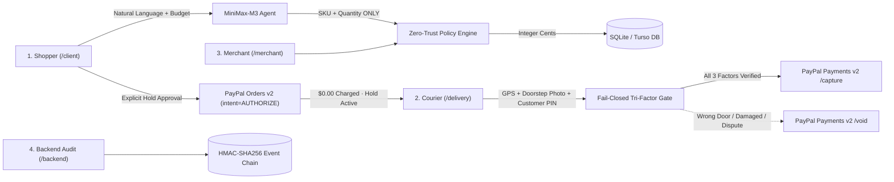
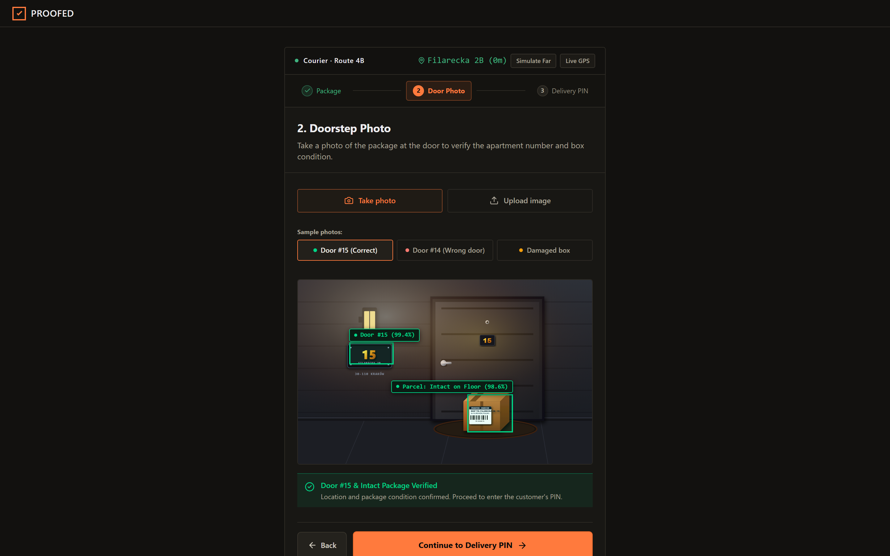
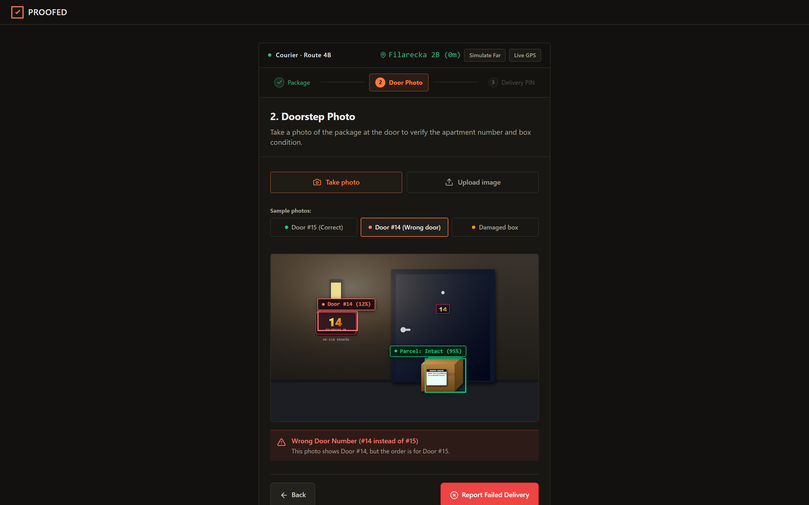
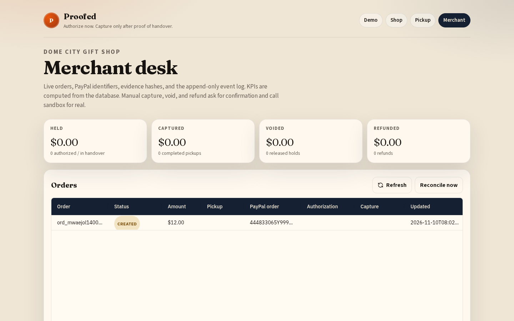
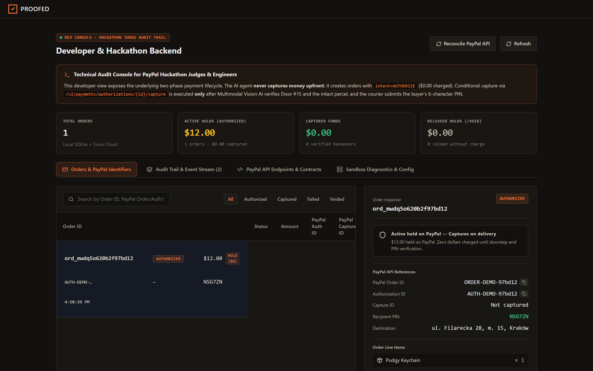
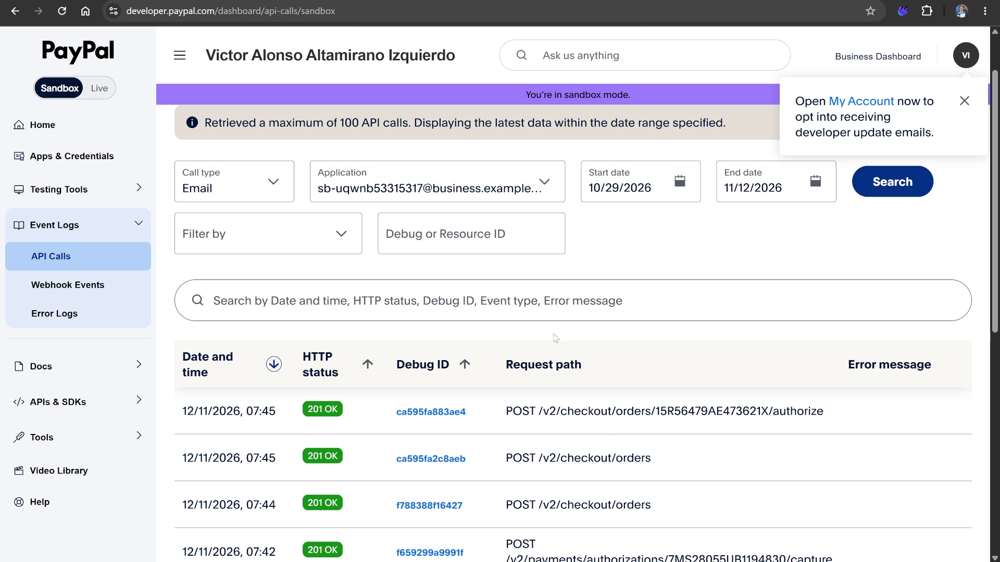
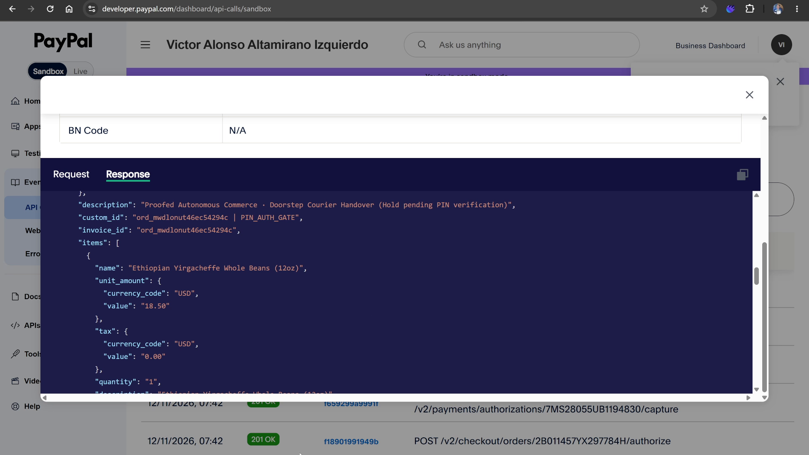
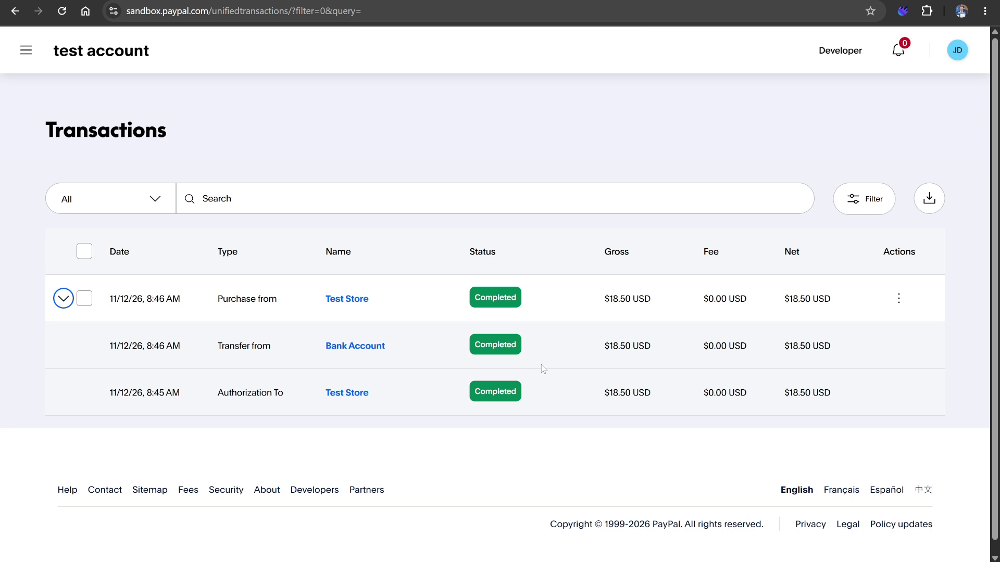
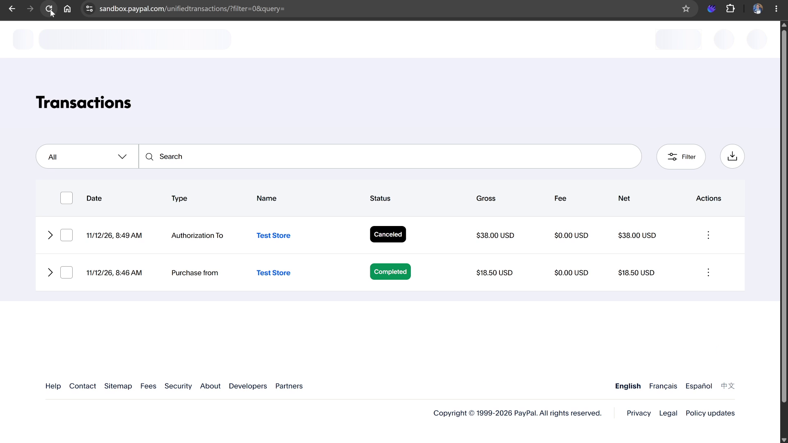

<p align="center">
  
</p>

<h1 align="center">Proofed</h1>

<p align="center">
  <strong>AI agents can buy in seconds, but what if delivery fails?</strong><br>
  <em>Proofed combines PayPal authorizations, AI vision, and recipient verification to capture payment only after handover—or void failed orders.</em>
</p>

<p align="center">
  <a href="https://proofed-ai.vercel.app"></a>
  <a href="#3-live-paypal-sandbox-verification--audit-evidence"></a>
  <a href="#8-developer-quickstart--test-suite"></a>
  <a href="LICENSE"></a>
</p>

---

## 1. Executive Summary & Thesis

> **AI agents can buy in seconds, but what if delivery fails?**

In autonomous AI commerce, an agent can find, negotiate, and initiate orders in milliseconds. But the moment physical delivery begins, the digital certainty breaks:
- **Couriers drop packages at the wrong door** (e.g. apartment `#14` instead of `#15`).
- **Parcels arrive crushed or damaged** on the doorstep.
- **Packages get stolen or left unattended** without physical handover.

### The Upfront Charge Trap (`intent=CAPTURE`)
Traditional e-commerce captures payment immediately at checkout (`intent: "CAPTURE"`). When physical delivery fails, buyers face frustrating dispute forms, merchants suffer chargeback penalties and frozen balances, and autonomous agent workflows grind to a halt.

### Proofed: The Conditional Physical Settlement Layer
Proofed binds payment settlement directly to verified physical reality using **PayPal Orders v2** and **PayPal Payments v2**:

1. **Authorize at Checkout (`$0.00` charged upfront)**: When the shopper approves an agent's order, Proofed creates an authorization hold via PayPal Orders v2 (`intent: "AUTHORIZE"`). Funds remain held in the buyer's account—no money is deducted upfront.
2. **Tri-Factor Doorstep Verification Protocol**:
   - **Factor 1 (GPS Geofence)**: Validates courier device coordinates against the delivery location before photo inspection.
   - **Factor 2 (Multimodal AI Vision)**: `MiniMax-M3.1-Flash` audits the doorstep photo for apartment doorplate match and package integrity with bounding boxes.
   - **Factor 3 (Courier-Blind Customer PIN)**: The courier must obtain the private 6-character code displayed only on the customer's `/client` screen.
3. **Conditional Settlement (`/capture` vs `/void`)**:
   - **Handover Verified**: Upon passing all 3 factors, Proofed executes PayPal Payments v2 `/capture` to settle merchant funds.
   - **Handover Failed**: If the courier attempts delivery at the wrong door or the parcel is damaged, capture is strictly blocked ($0.00 charged), and the hold is either rescheduled or safely released via PayPal Payments v2 `/void`.



---

## 2. Visual Walkthrough & System Screens

Proofed features four core operational views (plus `/demo` presenter) designed under a Swiss/Fintech dark aesthetic:

### 1. Shopper AI Assistant & PayPal Hold (`/client`)
Natural language product discovery, spoken budget enforcement, itemized order quoting, and explicit PayPal hold approval via PayPal Smart Buttons. The customer receives a private 6-character Delivery PIN.


*Key detail: The authorization places a temporary hold on the buyer's PayPal account. Exactly $0.00 is charged until delivery is physically verified.*

---

### 2. Courier Doorstep Handover Terminal (`/delivery`)

The mobile-first courier interface executes the 3-step verification protocol:
1. **Package Manifest**: Verifies package SKU, customer delivery address (`ul. Filarecka 2B, m. 15, Kraków`), and live GPS geofence proximity.
2. **Doorstep Photo**: Multimodal computer vision inspection powered by `MiniMax-M3.1-Flash`.
3. **Delivery PIN**: Enters the customer's one-time code to trigger settlement.

#### Door #15 Verified Handover (Success Path)
The computer vision engine detects apartment door number `#15` (99% confidence) and verifies package condition as intact on the floor (96% confidence). Green bounding box coordinates confirm handover criteria.



#### Door #14 Wrong Door Detection (Fail-Closed Exception Path)
When delivery is attempted at apartment `#14` instead of `#15`, the vision model immediately detects the mismatch (`Wrong Door Number (#14 instead of #15)`), blocks PIN entry, and disables payment capture.



*Result: The courier reports failed delivery. The buyer's hold remains uncaptured ($0.00 charged) and the customer is presented with 3 instant recovery options in `/client` (`I received the package`, `Send a replacement`, `Cancel & release hold`).*

---

### 3. Merchant Operations Desk (`/merchant`)
Operational order ledger with instant status filtering (Active Hold, Captured, Escalated / Review Required), itemized fulfillment details, and chronological audit timestamps.



---

### 4. Developer & Judge Backend Console (`/backend`)
Deep technical audit console exposing live PayPal Orders v2 & Payments v2 IDs, idempotency keys, state machine transitions, and HMAC-SHA256 signed event logs.



---

## 3. Live PayPal Sandbox Verification & Audit Evidence

The following evidence captures live transactions directly in the **PayPal Developer Dashboard** and **PayPal Sandbox Customer Account**, demonstrating the complete lifecycle of authorizations, conditional captures, and voids:

### A. PayPal Developer Dashboard — Live API Call History
Captured from `developer.paypal.com/dashboard/api-calls/sandbox`. Demonstrates real `201 OK` responses for:
- `POST /v2/checkout/orders` (Order Creation with `intent: "AUTHORIZE"`)
- `POST /v2/checkout/orders/{id}/authorize` (Payment Hold Authorization)
- `POST /v2/payments/authorizations/{id}/capture` (Conditional Settlement after physical proof)



---

### B. PayPal API Response Payload Inspection
Live inspection of the PayPal API response payload showing Proofed's strict cryptographic metadata:
- `description`: `"Proofed Autonomous Commerce · Doorstep Courier Handover (Hold pending PIN verification)"`
- `custom_id`: `"ord_mwdlonut46ec54294c | PIN_AUTH_GATE"`
- `invoice_id`: `"ord_mwdlonut46ec54294c"`
- `items`: Itemized integer-cent values (`$18.50 USD` for whole coffee beans)



---

### C. Buyer Sandbox Account — Post-Handover Capture ($18.50)
Captured from the buyer's PayPal Sandbox account (`sandbox.paypal.com/unifiedtransactions`). Demonstrates that:
1. At **8:45 AM**, an `Authorization To Test Store` (`$18.50 USD`) was placed with `$0.00` charged.
2. At **8:46 AM**, upon verified doorstep photo & recipient PIN entry, the payment settled as `Purchase from Test Store` (`$18.50 USD`) — `Completed`.



---

### D. Complete Lifecycle — Verified Capture vs Canceled/Voided Hold
Demonstrates both success and fail-closed branches in the same buyer account:
- **Captured Order ($18.50 USD)**: Handover verified at door `#15` $\rightarrow$ funds transferred to merchant (`Completed`).
- **Voided Order ($38.00 USD)**: Handover failed at door `#14` $\rightarrow$ authorization canceled (`Canceled`), hold immediately released with `$0.00` deducted.



---

## 4. Strict Architectural Invariants

Proofed enforces strict server-side invariants ensuring that **an untrusted client can submit evidence, but cannot declare payment authorization, physical verification, or settlement success**:

| Invariant | Implementation | Security Guarantee |
|---|---|---|
| **Zero-Trust AI Pricing** | `app/lib/policy.ts` | The LLM emits only `sku` and `quantity`. Prices, subtotals, and totals are computed strictly in TypeScript against database integer cents. The LLM cannot alter prices or apply unauthorized discounts. |
| **Integer Cents Standard** | `app/lib/money.ts` | All currency values are stored and calculated as integer cents (`$18.50` = `1850`). Floating point arithmetic for money is strictly prohibited. |
| **Authorize Before Capture** | `app/lib/paypal.ts` | Orders are created with `intent: "AUTHORIZE"`. Exactly `$0.00` is captured upfront. Captures are strictly conditional on physical delivery confirmation. |
| **Strict Capture Gate** | `app/lib/orders.ts` | `captureOrder()` rejects any order not in `DELIVERY_CONFIRMED` status. Handover evidence (`delivery_confirm` event) must be verified in the database before calling PayPal `/capture`. |
| **Fail-Closed Vision Audit** | `app/lib/vision-audit.ts` | Door photos are analyzed by `MiniMax-M3.1-Flash` with dynamic bounding boxes. Missing images, timeouts, or low confidence scores fail closed (`captureAuthorized: false`). |
| **Courier-Blind Delivery PIN** | `app/lib/orders.ts` | Courier queries return masked PINs (`pickup_code_masked: "••••••"`). Couriers must verbally obtain the code from the customer. 5-attempt retry limit. |
| **Append-Only Auditing** | `app/lib/orders.ts` | Every state change, tool call, and PayPal transaction is logged to `order_events` with HMAC-SHA256 cryptographic signatures. |
| **Deterministic Idempotency** | `app/lib/paypal.ts` | Every mutation sent to PayPal includes a deterministic `PayPal-Request-Id` header to prevent duplicate authorizations or captures. |
| **Node.js Built-In SQLite** | `app/lib/db.ts` | Uses Node 22+ native `node:sqlite` (with `@libsql/client` for Turso in serverless production), eliminating native C++ build dependencies. |

---

## 5. Application Routes & Navigation

| Route | View Name | Target User | Key Capabilities |
|---|---|---|---|
| [`/client`](https://proofed-ai.vercel.app/client) | **Shopper Assistant** | End Customer | Conversational AI shopping, spoken budget parsing, PayPal hold approval button, customer Delivery PIN, and delivery failure recovery. |
| [`/delivery`](https://proofed-ai.vercel.app/delivery) | **Courier Terminal** | Delivery Courier | 3-step doorstep workflow: Route 4B manifest + GPS geofence check $\rightarrow$ Door photo computer vision audit $\rightarrow$ Customer PIN entry. |
| [`/merchant`](https://proofed-ai.vercel.app/merchant) | **Merchant Desk** | Store Operations | Real-time order ledger, status categorization, dispute resolution, and fulfillment timelines. |
| [`/backend`](https://proofed-ai.vercel.app/backend) | **Judge & Dev Monitor** | Judges & Engineers | Live PayPal API request/response viewer, debug IDs, authorization tokens, state machine transitions, and HMAC event log. |
| [`/demo`](https://proofed-ai.vercel.app/demo) | **Synchronized Presenter** | Presenters | Side-by-side synchronized view showcasing the shopper chat, courier terminal, and merchant receipt in one screen. |

---

## 6. Order State Machine

```
              ┌─────────┐
              │ CREATED │
              └────┬────┘
                   │ Shopper clicks "PayPal Approve Hold"
                   ▼
              ┌──────────┐
              │ APPROVED │
              └────┬─────┘
                   │ POST /v2/checkout/orders/{id}/authorize ($0.00 charged)
                   ▼
             ┌────────────┐
             │ AUTHORIZED │
             └─────┬──────┘
                   │
         ┌─────────┴────────────────────────┐
         │ Tri-factor verification          │ Verification fails
         │ (GPS + Vision + PIN)             │ (Wrong door, damaged box)
         ▼                                  ▼
┌────────────────────┐            ┌─────────────────┐
│ DELIVERY_CONFIRMED │            │ DELIVERY_FAILED │
└────────┬───────────┘            └────────┬────────┘
         │                                 │
         │ POST /capture                   │ POST /void (or recovery)
         ▼                                 ▼
   ┌──────────┐                       ┌────────┐
   │ CAPTURED │                       │ VOIDED │
   └────┬─────┘                       └────────┘
        │ Post-capture dispute
        ▼
   ┌──────────┐
   │ REFUNDED │
   └──────────┘
```

---

## 7. PayPal API Integration Reference

Proofed interacts with the PayPal REST API v2 in sandbox mode:

1. **Create Order (Hold Intent)**:
   ```http
   POST /v2/checkout/orders
   Content-Type: application/json
   PayPal-Request-Id: {deterministic_uuid}

   {
     "intent": "AUTHORIZE",
     "purchase_units": [{
       "reference_id": "ord_12345",
       "amount": { "currency_code": "USD", "value": "18.50" }
     }]
   }
   ```
2. **Authorize Payment Hold**:
   ```http
   POST /v2/checkout/orders/{order_id}/authorize
   Content-Type: application/json
   ```
   *Returns `authorizations[0].id` and status `CREATED`. Funds are held; buyer's account shows pending authorization.*

3. **Capture Authorized Payment (Post-Handover Only)**:
   ```http
   POST /v2/payments/authorizations/{authorization_id}/capture
   Content-Type: application/json
   PayPal-Request-Id: {deterministic_uuid}

   {
     "final_capture": true
   }
   ```
   *Executed only when the order is in `DELIVERY_CONFIRMED` state with verified doorstep evidence.*

4. **Void Authorization (Delivery Failure or Cancellation)**:
   ```http
   POST /v2/payments/authorizations/{authorization_id}/void
   ```
   *Releases the hold immediately back to the buyer's PayPal balance/card.*

---

## 8. Recommended Demo Recording Script (2:25)

| Time | Scene | Action | Narrative |
|---|---|---|---|
| **0:00–0:25** | Intro & Thesis | Show [https://proofed-ai.vercel.app](https://proofed-ai.vercel.app) header & diagram. | *"AI commerce agents can initiate orders in milliseconds, but charging upfront exposes users to delivery failure. Proofed uses PayPal `intent=AUTHORIZE` to hold funds until physical delivery is verified."* |
| **0:25–0:55** | `/client` | Ask for an item (e.g. *"Coffee under $20"*). Click gold **PayPal Hold** button. | *"The agent quotes from our catalog in integer cents. The buyer approves the hold. Notice: $0.00 is charged today, and the buyer receives a private Delivery PIN."* |
| **0:55–1:35** | `/delivery` | Review Step 1 Manifest. Advance to Step 2, click `Door #15 (Correct)`. Enter PIN in Step 3. | *"The courier arrives at Filarecka 2B. Computer vision analyzes the door photo, verifying apartment #15 and intact package. Entering the customer PIN triggers PayPal `/capture`."* |
| **1:35–2:05** | `/delivery` | Start second order. In Step 2, click `Door #14 (Wrong door)`. | *"What if the courier drops it at the wrong door? Computer vision detects Door #14 instead of #15. Capture is blocked. Returning to `/client`, the buyer sees 3 instant recovery options."* |
| **2:05–2:25** | Sandbox & Audit | Show `/backend`, then open `developer.paypal.com` and `sandbox.paypal.com`. | *"In `/backend`, judges can inspect live PayPal authorization and capture IDs. The sandbox dashboard confirms the 201 OK capture, and the buyer's account proves $0.00 was charged until delivery was confirmed."* |

---

## 9. Developer Quickstart & Test Suite

### Prerequisites
- **Node.js 22+** (uses built-in `node:sqlite`)
- **npm 10+**

### Local Setup
```bash
# 1. Clone repository
git clone https://github.com/altaga/Proofed.git
cd Proofed

# 2. Install dependencies
npm install

# 3. Seed the SQLite catalog
npm run seed

# 4. Start local development server
npm run dev
# Open http://localhost:3000
```

### Running Tests
```bash
# Run core unit tests (state machine, policy, budget, text)
npm test

# Run vision & fraud audit tests (30 tests total)
npm --prefix app test tests/vision-audit.test.ts tests/fraud-audit.test.ts

# Run all test suites
npm run test:all

# Capture high-resolution Playwright screenshots
npm run screenshots
```

---

## 10. Project Structure

```
Proofed/
├── README.md                      # Comprehensive project documentation & live sandbox evidence
├── AGENTS.md                      # Autonomous agent operational manual & API catalog
├── package.json                   # Root package workspace scripts
├── scripts/
│   └── capture_screenshots.mjs    # Automated Playwright retina screenshot runner
├── docs/
│   ├── logo.svg                   # Vector brand identity mark
│   ├── ARCHITECTURE.md            # Deep system architecture & technical spec
│   ├── DEMO_SCRIPT.md             # Video demo script with timestamped narration
│   ├── PEER_AGENT_RESPONSE.md     # Technical response to adversarial audit
│   └── screenshots/               # High-resolution screenshots of all views & sandbox proofs
│       ├── client.png             # Shopper conversational interface
│       ├── delivery-step1.png     # Courier package manifest & GPS geofence
│       ├── delivery-door15.png    # Door #15 verified handover with bounding boxes
│       ├── delivery-door14.png    # Door #14 fail-closed mismatch detection
│       ├── merchant.png           # Merchant operations desk & order ledger
│       ├── backend.png            # Technical audit console for judges
│       ├── demo.png               # Synchronized presenter screen
│       ├── paypal-sand.png        # PayPal Developer Sandbox API call history (201 OK)
│       ├── paypal-sand-02.png     # PayPal API response payload inspection
│       ├── transactions1.png      # PayPal buyer account - Completed capture ($18.50)
│       └── transactions2.png      # PayPal buyer account - Capture vs Canceled void hold
├── rules/
│   ├── design-system.md           # Swiss/Fintech UI rules & color tokens
│   ├── fintech-guardrails.md      # Financial invariants and money handling
│   └── codebase-standards.md      # Code conventions & security rules
└── app/
    ├── app/                       # Next.js 15 App Router
    │   ├── client/                # Shopper conversational interface
    │   ├── delivery/              # Courier mobile terminal
    │   ├── merchant/              # Merchant desk ledger
    │   ├── backend/               # Technical inspector for judges
    │   ├── demo/                  # Synchronized presenter screen
    │   └── api/                   # REST API routes
    ├── components/                # Modular React 19 components
    ├── lib/                       # Core domain logic
    │   ├── db.ts                  # Node:sqlite / Turso database wrapper
    │   ├── orders.ts              # Order repository & event emitter
    │   ├── paypal.ts              # PayPal Orders v2 & Payments v2 client
    │   ├── policy.ts              # Zero-trust catalog policy engine
    │   ├── state-machine.ts       # Formal order lifecycle state machine
    │   ├── vision-audit.ts        # Multimodal MiniMax vision audit engine
    │   └── money.ts               # Integer cents formatting & arithmetic
    └── tests/                     # Unit, integration, and E2E test suites
```

---

## License

MIT License. See [LICENSE](LICENSE) for details.
