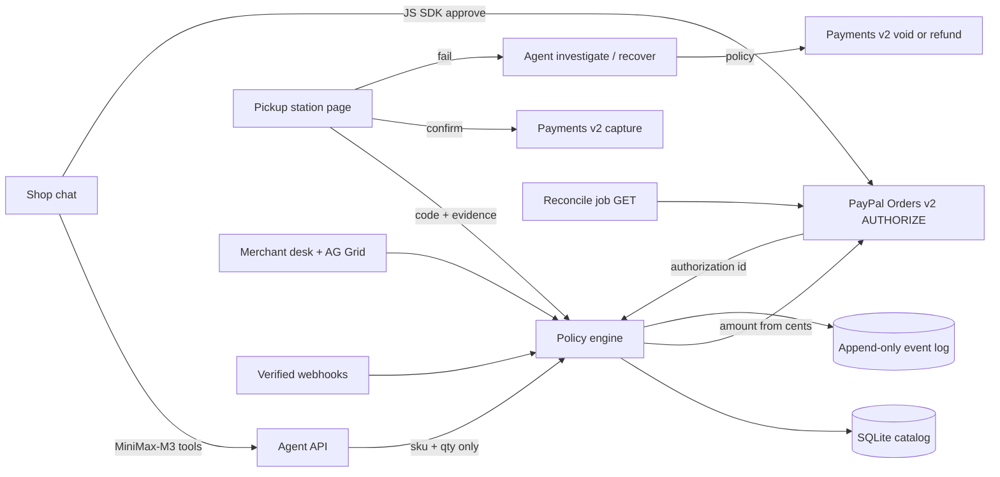
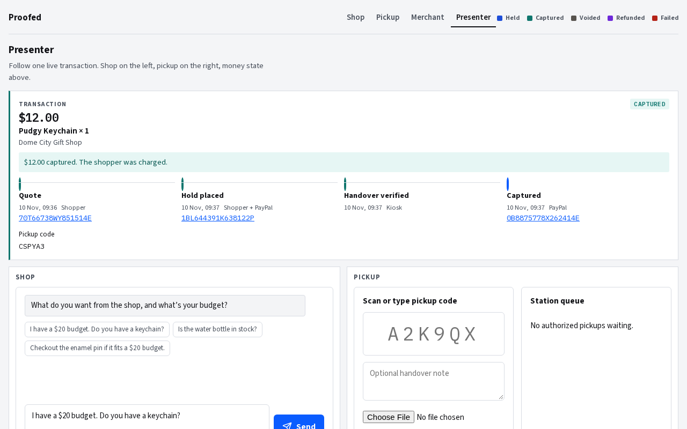
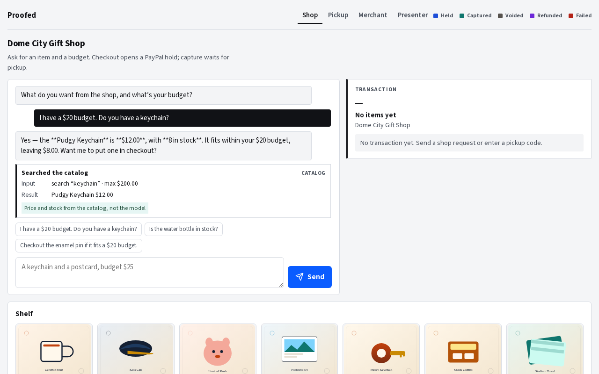
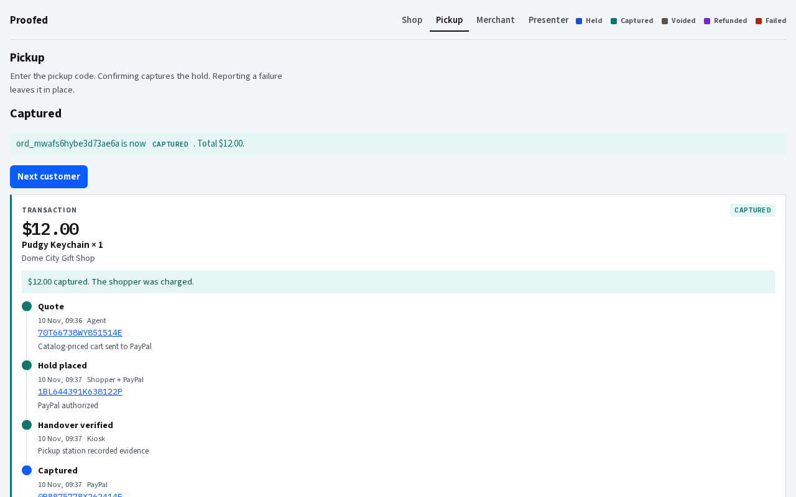

# Proofed

**Authorize now. Capture only after proof of handover.**

Proofed is an agentic checkout for a physical venue shop. A visitor talks to an assistant, the backend looks up a real catalog and places a PayPal Orders v2 payment with `intent=AUTHORIZE`, the visitor approves the hold, and a pickup-station page records handover evidence before the server captures. If handover fails, the assistant investigates and the backend voids (or refunds, if money was already captured).

This project was built for the [PayPal AI Hackathon](https://paypalaihackathon.devpost.com/) during 9–12 November 2026. It is new work after 1 October 2026.

## Why it exists

An AI agent can pick a souvenir in a stadium shop. The hard part is not the chat — it is payment accountability. Merchants should not capture funds before the item is handed over, and they should not keep a hold if the locker jams or stock disappears. PayPal already documents authorize-and-capture for that gap (hold for 29 days, honor period of 3 days, then capture or void). Proofed makes that loop visible: shopper, station, merchant desk, and an append-only event log.

The language model never chooses an amount. It may only pass SKUs and quantities. Prices, budgets, stock reservations, and PayPal totals are computed in TypeScript against SQLite.

## What you can do

- Talk naturally with a budget (“a keychain under $20”).
- See live stock, including a seeded out-of-stock water bottle (`DC-BTL-01`) for a real failure path.
- Approve a PayPal sandbox payment with the official JS SDK (`intent=authorize`).
- Confirm pickup on `/device` (software stand-in for a kiosk or locker) with a pickup code, note, and optional photo hash.
- Report a jam or no-show without capturing; the assistant can retry, substitute within budget, or cancel.
- Inspect every order on `/merchant` in AG Grid Community, with PayPal ids, evidence, and manual capture / void / refund (each asks for confirmation and calls sandbox for real).

## Architecture



State machine (illegal transitions are rejected and audited):

`CREATED → APPROVED → AUTHORIZED → DELIVERY_CONFIRMED → CAPTURED → REFUNDED`

Failures: `AUTHORIZED → DELIVERY_FAILED → AUTHORIZED` (retry) or `VOIDED`. Pickup timeout voids the hold. Capture decline is recorded from the real PayPal response, not invented.

The pickup “device” is not hardware and not a mock UI: it is a Next.js page that calls `/api/device/confirm` and `/api/device/fail` on the same server.

## How to run

Requirements: Node.js 22+ (Node 24 is what we developed on). SQLite is the built-in `node:sqlite` module, so there is no native `better-sqlite3` build step.

```bash
cp .env.example .env
# Fill PAYPAL_CLIENT_ID, PAYPAL_CLIENT_SECRET, MINIMAX_API_KEY
# Never commit .env
npm install
npm run seed          # optional; empty catalogs seed themselves
npm run dev           # http://localhost:3000
```

Pages:

- `/demo` — presenter view: live transaction receipt plus shop and pickup side by side
- `/` — shopper chat, agent action log, transaction receipt, shelf, PayPal Smart Buttons
- `/device` — pickup station with the same receipt and stepper
- `/merchant` — order table, KPIs, and a detail drawer with receipt, stepper, and event log

Screenshots (captured from the running app):








Rename the product in one place:

```bash
./scripts/rename.sh "New Name" new-slug
```

`project.config.json` is what the app reads. The rename script also updates human-facing copies in the README, demo script, and `package.json`.

Pack a downloadable zip (no `node_modules`, `.env`, database, or `.git`):

```bash
npm run pack
# writes /workspace/paypal-hack-dist/<slug>-<timestamp>.zip
```

### Environment

See `.env.example`. Secrets stay in the environment.

| Variable | Required | Purpose |
|---|---|---|
| `PAYPAL_CLIENT_ID` | yes | Sandbox REST app + JS SDK |
| `PAYPAL_CLIENT_SECRET` | yes | Server OAuth |
| `MINIMAX_API_KEY` | yes | Assistant at `https://api.minimax.io/v1` |
| `MINIMAX_MODEL` | no | Default `MiniMax-M3` from `project.config.json` |
| `PAYPAL_API_BASE` | no | Default `https://api-m.sandbox.paypal.com` |
| `PAYPAL_WEBHOOK_ID` | for live webhooks | Signature verification |
| `SQLITE_PATH` | no | Default `./data/app.sqlite` |

### Webhooks

`POST /api/paypal/webhooks` calls PayPal `verify-webhook-signature` when `PAYPAL_WEBHOOK_ID` is set. Without that id — typical on localhost — the handler accepts the HTTP request so you can see it is wired, but **it will not change order state**. Point a public HTTPS URL (Render, Vercel, or a tunnel) at that route, add the webhook in the PayPal Developer Dashboard, and store the webhook id.

Subscribe at least: `CHECKOUT.ORDER.APPROVED`, `PAYMENT.AUTHORIZATION.CREATED`, `PAYMENT.AUTHORIZATION.VOIDED`, `PAYMENT.CAPTURE.COMPLETED`, `PAYMENT.CAPTURE.DECLINED`, `PAYMENT.CAPTURE.REFUNDED`, `CHECKOUT.PAYMENT-APPROVAL.REVERSED`.

Locally and in production a reconcile job (`POST /api/jobs/reconcile`, also on a 60s timer) GETs stuck PayPal orders and authorizations, expires unused reservations, and voids pickup timeouts.

## How to try success and failure

Success:

1. Ask for a keychain with a $20 budget.
2. Confirm checkout. Approve the PayPal sandbox popup with a **Personal US** sandbox buyer.
3. Copy the pickup code to `/device`, confirm handover (optional photo). The authorization is captured for the catalog amount.
4. Open `/merchant` and inspect the capture id plus evidence hash.

Failure:

1. Ask for SKU `DC-BTL-01` (water bottle, seeded with 0 stock). The quote is rejected.
2. Place a real pin or postcard order, approve PayPal, then report a **station jam** on `/device`. Status becomes `DELIVERY_FAILED`; funds stay on hold.
3. Ask the assistant to investigate that order id and cancel or substitute. Cancel VOIDs the authorization. Substitute voids (or refunds) and opens a new AUTHORIZE order for replacement SKUs still inside the original budget.

Buyer approval cannot be skipped for PayPal Wallet. Sandbox card `payment_source` on this merchant app returned `UNPROCESSABLE_ENTITY` (Advanced Card processing does not appear to be enabled). Integration tests therefore create real AUTHORIZE orders, GET them, prove that authorize-before-approval returns `ORDER_NOT_APPROVED`, and exercise checkout-through-our-backend. Capture and void of an approved wallet payment are exercised in the UI once a buyer approves.

## Tests

```bash
npm test              # state machine + pricing/stock policy
npm run test:paypal   # live PayPal sandbox (create/GET/idempotency; authorize-before-approval)
npm run test:agent    # live MiniMax-M3 tool calling
npm run test:e2e      # Playwright: sandbox buyer approves, then capture/refund/substitute
npm run screenshots   # refresh docs/screenshots/*.png from the running UI
npm run demo:reset    # wipe orders/chats and restore seed stock
# optional: npm run demo:reset -- --live-holds
# creates two real CREATED PayPal AUTHORIZE orders (no mocks) so Merchant is not empty
npm run test:all
```

No mocked PayPal or MiniMax clients. If a credential is missing, those files skip instead of faking a pass.

`npm run test:e2e` needs a sandbox Personal buyer in `PAYPAL_BUYER_EMAIL` and `PAYPAL_BUYER_PASSWORD`, plus the merchant REST credentials. After `npm install`, run `npx playwright install chromium` once. It opens the real `sandbox.paypal.com` approve/payer-action link, logs in, then drives `/device` and the authorize/capture/void/refund APIs. Results are checked against PayPal REST GET. Playwright traces, videos, and automatic screenshots are off so credentials are not written to disk; failure screenshots in `test-artifacts/` clear email/password fields first.

## What is new since 1 October 2026

The entire application — schema, policy engine, PayPal authorize/capture/void/refund client, MiniMax tool loop, pickup station, merchant desk, tests, and this README — was written for this hackathon window. It is not an existing production app with a thin wrapper.

## AI tools used

- **MiniMax-M3** via the OpenAI-compatible API at `https://api.minimax.io/v1` is the in-product shopping assistant (function calling). Tool results are executed in process against SQLite and PayPal.
- **Grok Bot** (the operator’s coding assistant) was used to implement the repository: research, project scaffolding, and application code. It did not invent PayPal responses; sandbox calls are live.

## License

MIT. See `LICENSE`.
