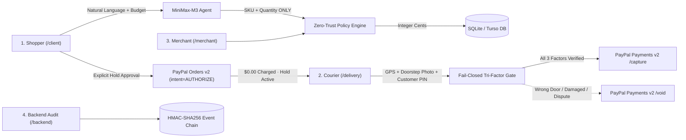

# Proofed

**Authorize now. Capture only after verified proof of physical handover.**

> Proofed is the trust and settlement layer between autonomous AI commerce agents and the physical world. Built for the **PayPal AI Hackathon** (November 2026).  
> **Live Production App**: [https://proofed-ai.vercel.app](https://proofed-ai.vercel.app)

---

## 1. Executive Summary & Thesis

Autonomous AI agents can negotiate and initiate purchases in milliseconds. However, agentic physical commerce suffers from a critical **accountability gap**:

1. **Pre-charging risk (`intent=CAPTURE`)**: Charging a buyer's payment method upfront exposes shoppers and merchants to costly chargebacks when a courier delivers to the wrong address, damages the parcel, or fails delivery.
2. **Unchecked AI pricing**: Language models hallucinate prices, applied discounts, and totals when left unconstrained.
3. **PayPal's Conditional Settlement Primitive**: PayPal Orders v2 supports `intent: "AUTHORIZE"`, placing a 29-day authorization hold with a 3-day honor window (`$0.00` charged upfront). 

**Proofed binds funds capture strictly to physical reality.** When an AI shopping assistant helps a customer find an item, the buyer approves a conditional hold. Funds remain held on PayPal until a **tri-factor physical handover protocol** (GPS geofence, multimodal computer vision inspection via `MiniMax-M3.1-Flash`, and a courier-blind customer PIN) verifies delivery at the doorstep. Only upon verified handover does the server execute PayPal Payments v2 `/capture`. If delivery fails, the hold is never captured and can be re-routed or released via `/void`.



---

## 2. Visual Walkthrough & System Screens

Proofed features four core operational views (plus `/demo` presenter) designed under a Swiss/Fintech dark aesthetic:

### 1. Shopper AI Assistant & PayPal Hold (`/client`)
Natural language product discovery, spoken budget enforcement, itemized order quoting, and explicit PayPal hold approval via PayPal Smart Buttons. The customer receives a private 6-character Delivery PIN.


*Key detail: The authorization places a temporary hold on the buyer's PayPal account. Exactly $0.00 is charged until delivery is physically verified.*

---

### 2. Courier Doorstep Handover Terminal (`/delivery`)

The mobile-first courier interface executes the 3-step verification protocol:
1. **Package Manifest**: Verifies package SKU, customer delivery address (`ul. Filarecka 2B, m. 15, Kraków`), and live GPS geofence proximity.
2. **Doorstep Photo**: Multimodal computer vision inspection powered by `MiniMax-M3.1-Flash`.
3. **Delivery PIN**: Enters the customer's one-time code to trigger settlement.

#### Door #15 Verified Handover (Success Path)
The computer vision engine detects apartment door number `#15` (99% confidence) and verifies package condition as intact on the floor (96% confidence). Green bounding box coordinates confirm handover criteria.


#### Door #14 Wrong Door Detection (Fail-Closed Exception Path)
When delivery is attempted at apartment `#14` instead of `#15`, the vision model immediately detects the mismatch (`Wrong Door Number (#14 instead of #15)`), blocks PIN entry, and disables payment capture.


*Result: The courier reports failed delivery. The buyer's hold remains uncaptured ($0.00 charged) and the customer is presented with 3 instant recovery options in `/client` (`I received the package`, `Send a replacement`, `Cancel & release hold`).*

---

### 3. Merchant Operations Desk (`/merchant`)
Operational order ledger with instant status filtering (Active Hold, Captured, Escalated / Review Required), itemized fulfillment details, and chronological audit timestamps.


---

### 4. Developer & Judge Backend Console (`/backend`)
Deep technical audit console exposing live PayPal Orders v2 & Payments v2 IDs, idempotency keys, state machine transitions, and HMAC-SHA256 signed event logs.


---

## 3. Strict Architectural Invariants

Proofed enforces strict server-side invariants ensuring that **an untrusted client can submit evidence, but cannot declare payment authorization, physical verification, or settlement success**:

| Invariant | Implementation | Security Guarantee |
|---|---|---|
| **Zero-Trust AI Pricing** | `app/lib/policy.ts` | The LLM emits only `sku` and `quantity`. Prices, subtotals, and totals are computed strictly in TypeScript against database integer cents. The LLM cannot alter prices or apply unauthorized discounts. |
| **Integer Cents Standard** | `app/lib/money.ts` | All currency values are stored and calculated as integer cents (`$18.50` = `1850`). Floating point arithmetic for money is strictly prohibited. |
| **Authorize Before Capture** | `app/lib/paypal.ts` | Orders are created with `intent: "AUTHORIZE"`. Exactly `$0.00` is captured upfront. Captures are strictly conditional on physical delivery confirmation. |
| **Strict Capture Gate** | `app/lib/orders.ts` | `captureOrder()` rejects any order not in `DELIVERY_CONFIRMED` status. Handover evidence (`delivery_confirm` event) must be verified in the database before calling PayPal `/capture`. |
| **Fail-Closed Vision Audit** | `app/lib/vision-audit.ts` | Door photos are analyzed by `MiniMax-M3.1-Flash` with dynamic bounding boxes. Missing images, timeouts, or low confidence scores fail closed (`captureAuthorized: false`). |
| **Courier-Blind Delivery PIN** | `app/lib/orders.ts` | Courier queries return masked PINs (`pickup_code_masked: "••••••"`). Couriers must verbally obtain the code from the customer. 5-attempt retry limit. |
| **Append-Only Auditing** | `app/lib/orders.ts` | Every state change, tool call, and PayPal transaction is logged to `order_events` with HMAC-SHA256 cryptographic signatures. |
| **Deterministic Idempotency** | `app/lib/paypal.ts` | Every mutation sent to PayPal includes a deterministic `PayPal-Request-Id` header to prevent duplicate authorizations or captures. |
| **Node.js Built-In SQLite** | `app/lib/db.ts` | Uses Node 22+ native `node:sqlite` (with `@libsql/client` for Turso in serverless production), eliminating native C++ build dependencies. |

---

## 4. Application Routes & Navigation

| Route | View Name | Target User | Key Capabilities |
|---|---|---|---|
| [`/client`](https://proofed-ai.vercel.app/client) | **Shopper Assistant** | End Customer | Conversational AI shopping, spoken budget parsing, PayPal hold approval button, customer Delivery PIN, and delivery failure recovery. |
| [`/delivery`](https://proofed-ai.vercel.app/delivery) | **Courier Terminal** | Delivery Courier | 3-step doorstep workflow: Route 4B manifest + GPS geofence check $\rightarrow$ Door photo computer vision audit $\rightarrow$ Customer PIN entry. |
| [`/merchant`](https://proofed-ai.vercel.app/merchant) | **Merchant Desk** | Store Operations | Real-time order ledger, status categorization, dispute resolution, and fulfillment timelines. |
| [`/backend`](https://proofed-ai.vercel.app/backend) | **Judge & Dev Monitor** | Judges & Engineers | Live PayPal API request/response viewer, debug IDs, authorization tokens, state machine transitions, and HMAC event log. |
| [`/demo`](https://proofed-ai.vercel.app/demo) | **Synchronized Presenter** | Presenters | Side-by-side synchronized view showcasing the shopper chat, courier terminal, and merchant receipt in one screen. |

---

## 5. Order State Machine

```
              ┌─────────┐
              │ CREATED │
              └────┬────┘
                   │ Shopper clicks "PayPal Approve Hold"
                   ▼
              ┌──────────┐
              │ APPROVED │
              └────┬─────┘
                   │ POST /v2/checkout/orders/{id}/authorize ($0.00 charged)
                   ▼
             ┌────────────┐
             │ AUTHORIZED │
             └─────┬──────┘
                   │
         ┌─────────┴────────────────────────┐
         │ Tri-factor verification          │ Verification fails
         │ (GPS + Vision + PIN)             │ (Wrong door, damaged box)
         ▼                                  ▼
┌────────────────────┐            ┌─────────────────┐
│ DELIVERY_CONFIRMED │            │ DELIVERY_FAILED │
└────────┬───────────┘            └────────┬────────┘
         │                                 │
         │ POST /capture                   │ POST /void (or recovery)
         ▼                                 ▼
   ┌──────────┐                       ┌────────┐
   │ CAPTURED │                       │ VOIDED │
   └────┬─────┘                       └────────┘
        │ Post-capture dispute
        ▼
   ┌──────────┐
   │ REFUNDED │
   └──────────┘
```

---

## 6. PayPal API Integration Reference

Proofed interacts with the PayPal REST API v2 in sandbox mode:

1. **Create Order (Hold Intent)**:
   ```http
   POST /v2/checkout/orders
   Content-Type: application/json
   PayPal-Request-Id: {deterministic_uuid}

   {
     "intent": "AUTHORIZE",
     "purchase_units": [{
       "reference_id": "ord_12345",
       "amount": { "currency_code": "USD", "value": "18.50" }
     }]
   }
   ```
2. **Authorize Payment Hold**:
   ```http
   POST /v2/checkout/orders/{order_id}/authorize
   Content-Type: application/json
   ```
   *Returns `authorizations[0].id` and status `CREATED`. Funds are held; buyer's account shows pending authorization.*

3. **Capture Authorized Payment (Post-Handover Only)**:
   ```http
   POST /v2/payments/authorizations/{authorization_id}/capture
   Content-Type: application/json
   PayPal-Request-Id: {deterministic_uuid}

   {
     "final_capture": true
   }
   ```
   *Executed only when the order is in `DELIVERY_CONFIRMED` state with verified doorstep evidence.*

4. **Void Authorization (Delivery Failure or Cancellation)**:
   ```http
   POST /v2/payments/authorizations/{authorization_id}/void
   ```
   *Releases the hold immediately back to the buyer's PayPal balance/card.*

---

## License

MIT License. See [LICENSE](LICENSE) for details.
