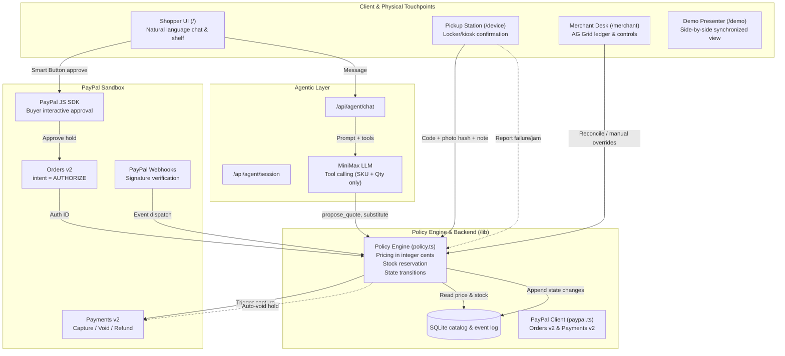
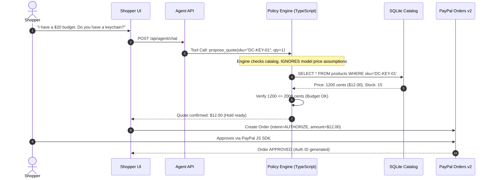
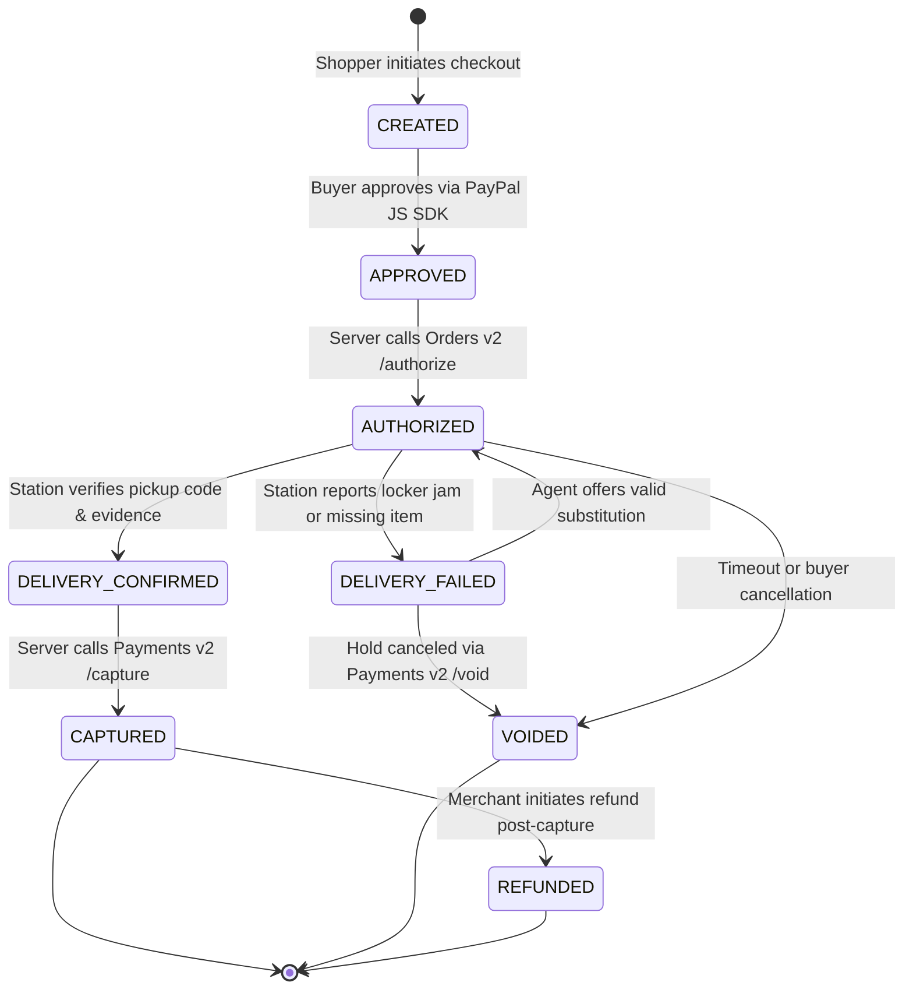

# Proofed — System Architecture & Design

Proofed is an agentic physical commerce platform featuring guaranteed payment accountability. It enforces a strict principle: **Authorize now. Capture only after proof of handover.**

---

## 1. High-Level System Flow

---

## 2. Zero-Trust AI Payment Model

A fundamental flaw in naive agentic commerce is allowing language models to determine monetary values. Proofed solves this through strict separation of responsibilities:

| Responsibility | Handled By | Guardrail Enforced |
|---|---|---|
| Natural dialogue | MiniMax LLM | Evaluates buyer intent, suggests SKUs |
| Price calculation | Policy Engine (`lib/policy.ts`) | **Calculated from SQLite catalog cents**. LLM amounts are rejected. |
| Budget enforcement | Backend Parser (`lib/budget.ts`) | Shopper's stated budget is parsed into cents and checked server-side. |
| Stock reservation | SQLite Database (`lib/db.ts`) | Orders cannot be created if inventory is `0` (e.g. `DC-BTL-01`). |
| Payment creation | PayPal Client (`lib/paypal.ts`) | Fixed `intent: "AUTHORIZE"`, amount locked to server quote cents. |

---

## 3. Order Lifecycle State Machine

Transitions between states are deterministic and strictly enforced by `lib/state-machine.ts`. Any illegal transition is rejected and logged.

### Transition Matrix

| Current State | Allowed Next State | Action / Trigger |
|---|---|---|
| `CREATED` | `APPROVED` | Shopper completes PayPal SDK popup |
| `APPROVED` | `AUTHORIZED` | Backend authorizes hold via `/v2/checkout/orders/{id}/authorize` |
| `AUTHORIZED` | `DELIVERY_CONFIRMED` | Pickup station submits valid pickup code & evidence |
| `AUTHORIZED` | `DELIVERY_FAILED` | Station reports locker jam, damaged goods, or timeout |
| `AUTHORIZED` | `VOIDED` | Handover canceled or unresolvable; hold voided in PayPal |
| `DELIVERY_CONFIRMED` | `CAPTURED` | Backend successfully captures funds via Payments v2 |
| `DELIVERY_FAILED` | `AUTHORIZED` | Shopper/Agent agrees to substitute item; hold updated/reissued |
| `DELIVERY_FAILED` | `VOIDED` | Substitution rejected; original authorization voided |
| `CAPTURED` | `REFUNDED` | Goods returned or merchant desk manual refund |

---

## 4. Physical Handover Evidence System

In physical retail (stadiums, micro-kiosks, unattended lockers), holding funds prevents charging the consumer before they actually receive the goods.

1. **Pickup Code**: A cryptographically random, human-friendly code generated upon authorization.
2. **Photo Hash (Optional)**: SHA-256 hash of locker sensor capture or operator snapshot.
3. **Station Identifier & Note**: Metadata identifying the physical terminal executing the transaction.
4. **Append-Only Event Store**: Every handover attempt, failure trace, and capture timestamp is written to the SQLite `order_events` table with immutable timestamps.

---

## 5. Security & Idempotency

- **Idempotency Keys**: All state-modifying requests to PayPal include an idempotency header (`PayPal-Request-Id: {orderId}-{action}-{timestamp}`).
- **Webhook Verification**: PayPal incoming webhook signatures (`PAYPAL-AUTH-ALGO`, `PAYPAL-TRANSMISSION-ID`, `PAYPAL-CERT-URL`, `PAYPAL-TRANSMISSION-SIG`) are verified via PayPal's verification endpoint before processing.
- **Local Fallback Reconciliation**: A background reconciliation job continuously polls PayPal for status consistency in sandbox environments where webhooks are not publicly routable.
- **Zero Native SQLite Dependencies**: Built on Node.js 22+ native `node:sqlite`, eliminating native C++ binary build issues across macOS, Linux, and Windows.
